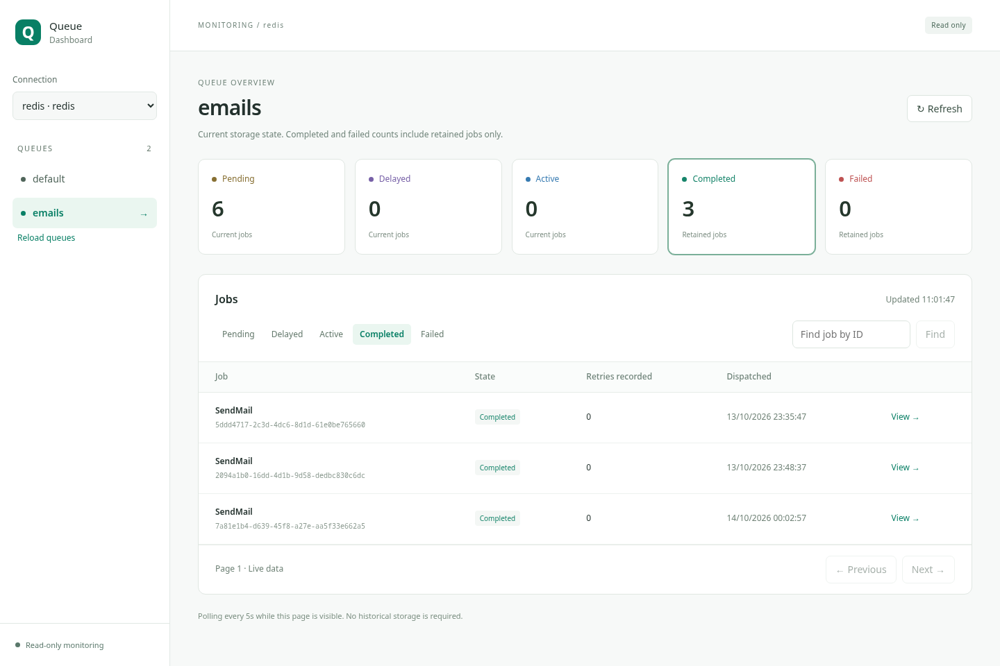
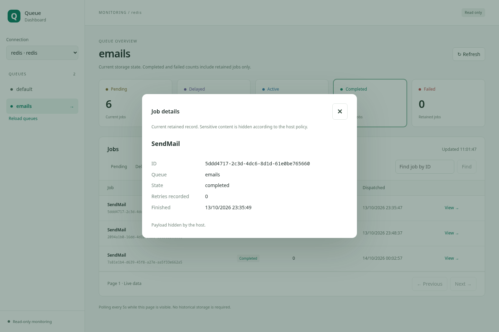

# @jrmc/adonis-queue-dashboard

A standalone dashboard for AdonisJS 7 and `@adonisjs/queue` 0.6.2 or 0.7.x.
It reads existing Redis or Database queue storage without an additional history database.
Vue 3, Tailwind CSS 4, and Reka UI assets are compiled into the package: the host
application needs no frontend framework or Vite configuration.
The dashboard automatically follows the system light or dark theme, including changes
made while it is open.

Internal storage readers recognize `@boringnode/queue` 0.6.0 and stable 0.9.x releases.
The 0.9 storage family was audited against 0.9.0 and 0.9.1; new minor versions and
prereleases require a separate compatibility review.
Unknown storage versions fall back to the public Queue API.



## Installation

Requires Node.js 24 or later, AdonisJS 7, and `@adonisjs/queue` 0.6.2 or 0.7.x.
The host application must have a working Redis or Lucid connection for the chosen driver.

Install the dashboard from npm and run its configure hook with one command:

```sh
node ace add @jrmc/adonis-queue-dashboard
```

Register the Dashboard provider **after** the Redis/Lucid and Queue providers.
The configure hook creates `config/queue_dashboard.ts` and makes the router method
available; it does not mount routes or create tables or connections.

## Configuration

### Configure `@adonisjs/queue`

When upgrading an existing app to Queue 0.7.0 (Boring Queue 0.9.0), stop every process running the old
version (HTTP server, workers, and scheduler), then run the Queue storage migrations before restarting them:

```sh
node ace queue:migrate
```

Follow [Queue's upgrade instructions](https://docs.adonisjs.com/guides/digging-deeper/queues)
for SQL schema migrations and any database timezone options. The dashboard never
migrates storage itself. Queue 0.7.0 requires `@adonisjs/core` 7.6 or later.

If Queue is not installed yet, install and configure the supported version:

```sh
node ace add @adonisjs/queue@0.7.0
```

Choose the Database or Redis driver during setup. If Queue is already installed
but has not been configured, run `node ace configure @adonisjs/queue` instead.
Keep the Dashboard provider after the Redis/Lucid and Queue providers in `adonisrc.ts`.

For Database, configure a working `primary` connection in `config/database.ts`
and use the following `config/queue.ts`:

```ts
import env from '#start/env'
import { defineConfig, drivers } from '@adonisjs/queue'

export default defineConfig({
  default: env.get('QUEUE_DRIVER', 'database'),
  adapters: {
    database: drivers.database({ connectionName: 'primary' }),
    sync: drivers.sync(),
  },
  worker: {
    concurrency: 5,
    idleDelay: '2s',
  },
  locations: ['./app/jobs/**/*.{ts,js}'],
  defaultJobOptions: {
    removeOnComplete: { count: 200 },
    removeOnFail: { count: 200 },
  },
})
```

Set `QUEUE_DRIVER=database` in `.env`, then run the migration generated by Queue
to create `queue_jobs` and `queue_schedules`:

```sh
node ace migration:run
```

Retaining completed and failed jobs lets you inspect them after execution.
Without retention, a job may be processed and deleted before the dashboard refreshes.

### Configure the dashboard

The generated `config/queue_dashboard.ts` has an empty `adapters` object.
Add an adapter matching `config/queue.ts`; adapter names, connections, and table
names must match exactly. For the Database configuration above:

```ts
import { defineConfig } from '@jrmc/adonis-queue-dashboard'

export default defineConfig({
  adapters: {
    database: {
      source: {
        driver: 'database',
        connectionName: 'primary',
        tableName: 'queue_jobs',
      },
      queues: ['default', 'emails'],
      allowedQueues: ['default', 'emails'],
    },
  },
  pollIntervalMs: 5000,
  maxPageSize: 50,
})
```

For Redis, use `redis: drivers.redis({ connectionName: 'main' })` in
`config/queue.ts`, set `QUEUE_DRIVER=redis`, and replace the dashboard's
`database` adapter with:

```ts
redis: {
  source: { driver: 'redis', connectionName: 'main' },
  queues: ['default', 'emails'],
  allowedQueues: ['default', 'emails'],
},
```

Configure the `main` connection in `config/redis.ts`. Redis does not need the
Queue database migration. The host application's `ioredis` connection supplies
its database and `keyPrefix`: the dashboard adds no default prefix.

### Mount and open the dashboard

In `start/routes.ts`, mount the dashboard with your application's authentication
middleware:

```ts
import router from '@adonisjs/core/services/router'
import { middleware } from '#start/kernel'

router.queueDashboard('/queue').use(middleware.auth())
```

Start the application and, in a separate terminal, a worker for the configured queues:

```sh
node ace serve --watch
```

```sh
node ace queue:work --queue=default,emails
```

Open `/queue` on your application's URL after signing in. The dashboard reads
existing jobs; dispatch jobs from your application to populate it. Restart workers
after changing `config/queue.ts`.

## Dashboard options

The sidebar's **Adapter** selector lists the entries in `config/queue_dashboard.ts`.
Each adapter selects its own Redis or Database connection and storage. You can
configure several adapters of the same driver with different connections.
The selected adapter determines which queues and schedules are displayed.

### Routes and middleware

The method returns a **native AdonisJS `RouteGroup`**. Its middleware apply to
the HTML page, JSON endpoints, and assets. The host application chooses its
authentication and authorization middleware and their options:

```ts
router.queueDashboard('/queue').use([middleware.auth(), middleware.queueAdmin()])
```

`queueAdmin` represents application middleware you must create and register in
the kernel if you want this access policy. The package does not add access
middleware implicitly: mounting without `.use(...)` makes the dashboard public.

Parent groups also work; asset and API URLs use the actual mounted path:

```ts
router
  .group(() => {
    router.queueDashboard('/queues').use(middleware.auth())
  })
  .prefix('/admin')
```

The method is available in console environments for route listing commands.
Dashboard readers and connections are resolved on the first authorized request,
rather than when the provider loads.

For Sync, use `{ driver: 'sync' }`; there are no persistent jobs to list.

`queues` keeps configured queues visible even when they are empty.
`allowedQueues` is an exact list of permitted names; `[]` hides all queues.
Omitting it allows discovery in that adapter's storage.
Redis discovers queues progressively and reports incomplete discovery. Use
“Reload queues” to continue. SQL discovery returns at most 1,000 stored queues.
There is no global payload search.

### Schedules

Schedules are disabled by default. Enable them explicitly on each dashboard adapter:

```ts
schedules: { enabled: true },
```

This grants read access to all schedules on that adapter, including lookup by ID.
`allowedQueues` does not restrict schedules: Boring 0.6.0 and 0.9.x store no queue on a
schedule. The worker resolves the queue from the job class when dispatching.
The Schedules tab filters by adapter and active/paused status and displays cron
or interval, timezone, next run, recorded runs, boundaries, and run limit.
Payloads follow the same redaction policy as jobs.

**Next run** shows a countdown based on the persisted `nextRunAt`, refreshed every
second while the page is visible without additional storage requests. Hover over
it for the exact date in the browser's local timezone; schedule details also show
that date alongside the countdown. The schedule's timezone column describes cron
evaluation, not the browser's display timezone.
A missing next run displays “No next run scheduled”; a reached deadline displays
“Due now”, then “Overdue by …”. These labels describe the stored deadline and do
not confirm that a worker has started the job. Paused schedules can retain a next
run date: the countdown does not mean they will dispatch while paused.

For Database, set `source.schedulesTableName` when the queue adapter uses a custom
schedules table (default: `queue_schedules`). The host must create that table using
Queue's schema service. A missing or incompatible schedules table disables schedule
reading without disabling jobs; the dashboard never creates or migrates tables.

Redis lists IDs with SSCAN and hydrates bounded pages through public `getSchedule()`;
SQL paginates by ID. Cursors are scoped to adapter and status. Redis pages can be
empty after status filtering and have no chronological ordering. Continue when a
next cursor is available. Both listings are live, so concurrent changes can cause
duplicates or omissions. Sync has no persistent schedules. With an unsupported
storage version, listing is unavailable; public lookup remains available when the
adapter supports it and schedules are enabled.

`runCount` and `lastRunAt` reflect schedule claims, not successful execution.
An active schedule can have no next run after reaching its limit or end boundary.
There is no stored link from a schedule to individual job executions in this version.
Schedule details expose **Pause**, **Resume**, **Run now**, and **Delete schedule**.
Actions are enabled by default with `@adonisjs/queue` 0.7.x / Boring Queue 0.9.x
for adapters with schedule access enabled. Queue 0.6.2 retains consultation access;
its Schedule API cannot target an adapter explicitly. Unknown storage versions
also keep actions disabled. Delete
requires confirmation and does not remove already queued jobs. Run now uses the
stored payload, can run a paused schedule, and respects its run limit. It queues
a job; it does not wait for successful execution. Native Queue concurrency semantics
apply: pausing or deleting does not cancel an execution already claimed by a worker.

Protect the entire route group with authentication and authorization middleware.
POST actions inherit the same middleware as reads. The dashboard requires a custom
request header to prevent cross-origin form submissions; do not enable permissive
CORS on these routes. When using Shield CSRF protection, enable its XSRF cookie
(`enableXsrfCookie: true`); the frontend forwards it as `X-XSRF-TOKEN`.

To keep an installation in consultation mode, set `readOnly: true` in
`config/queue_dashboard.ts`. This hides action buttons and rejects mutations on the
server. It defaults to `false`. Jobs, including failed jobs, remain read-only.
Actions use the public Queue API and require no direct storage writes by the dashboard.
A failed action may have partially completed; refresh before retrying.

### Sensitive data

Payloads are omitted and error messages are hidden by default. To display them,
set `redaction` at the root of `config/queue_dashboard.ts`, alongside `adapters`,
with a policy suited to your application's secrets:

```ts
redaction: {
  showPayload: true,
  sensitiveKeys: ['customerPrivateData'],
  redactText: (text) => text.replace(/Bearer\s+\S+/gi, 'Bearer [Redacted]'),
  maxDepth: 5,
  maxEntries: 200,
  maxStringLength: 2000,
}
```

This callback is an **example to customize**: a generic expression cannot identify
all your application's secrets. Common keys such as password, token, secret,
credentials, cookie, authorization, and their variants are redacted recursively.
The callback processes strings and errors before serialization. The page renders
values as escaped text.

Job details in Mira, with the payload hidden by the host's redaction policy:



## Capabilities and limitations

| Driver                         | Counts and listing           | Details                                 | Limitations                                                            |
| ------------------------------ | ---------------------------- | --------------------------------------- | ---------------------------------------------------------------------- |
| Redis / Boring 0.6.0, 0.9.x    | All states, bounded pages    | Public `getJob()` with storage overlays | Pages can change; active scans have no chronological order             |
| Database / Boring 0.6.0, 0.9.x | All states, pagination by ID | Public `getJob()`                       | Targets SQLite and PostgreSQL; explicit table/connection configuration |
| Sync                           | Unavailable                  | Unavailable                             | Immediate execution without storage                                    |
| Unknown Boring version         | Fallback: `pending` count    | Public lookup by ID                     | Internal listing disabled                                              |

The `completed` and `failed` counts describe **retained jobs**, not historical
totals. Jobs may be deleted automatically after completion according to
`removeOnComplete` and `removeOnFail`. The package does not change these settings.

For a retention period of 7 days:

```ts
defaultJobOptions: {
  removeOnComplete: { age: '7d' },
  removeOnFail: { age: '7d' },
},
```

You can combine both limits with `{ age: '7d', count: 200 }`: a job is removed when
it exceeds either limit. Cleanup happens when new jobs are finalized in the same
queue and state; it is not an automatic expiration at an exact time.

Queue or job class options can override these values. Restart workers after
changing their configuration. Also check the selected queue, adapter, and dashboard
connection: logs alone do not guarantee that the dashboard reads the same storage.
An empty list does not prove that no jobs have run. Displayed attempts reflect the
stored field, not a history of every execution.

Filters cover adapter, queue, and state. Pagination follows ID order in SQL,
sorted set order in Redis, and HSCAN traversal for active jobs.
Pages may be partial if jobs disappear or change state. Cursors are scoped to
the adapter, queue, and state and do not guarantee a snapshot. Job details are
also available through a lookup by ID.

Polling avoids overlapping refresh requests, pauses when the tab is hidden,
and backs off on errors. SSE, historical telemetry, charts, administrative retries,
deletion, and worker control remain future steps. Telemetry interfaces are defined
in the package types; no collector is enabled in this MVP.

## Development

To work on the package from this repository:

```sh
npm ci
npm run typecheck
npm test
```

`npm test` runs lint and builds the package before running the unit and integration
tests. Use `npm pack` to build a tarball for testing in another application.

## Demo and tests

After building, start the demo application with a password supplied through
the environment:

```sh
npm run build
DASHBOARD_PASSWORD=demo-local npm run demo
```

Open `http://127.0.0.1:3333/admin/queues` with username `operator` and the password
provided in `DASHBOARD_PASSWORD` (`demo-local` in this example). The demo uses the
real Core, Lucid, and Queue providers and an isolated SQLite database in memory,
recreated on every launch. It populates multiple job states and recurring schedules with sample data.
Basic authentication is used for this local demo; integrate the host application's
access policy for a real application.

`npm test` runs lint, builds the package, and executes tests for SQLite, Adonis
handlers, provider boot, security, and the Redis command contract. The two service
tests are skipped unless these variables are set:

- `QUEUE_DASHBOARD_TEST_REDIS_URL`: a test Redis instance; each run uses a unique
  namespace and only cleans that namespace, with no `FLUSHDB`.
- `QUEUE_DASHBOARD_TEST_DATABASE_URL`: PostgreSQL with a database named
  `queue_dashboard_test` required; a unique temporary table is dropped after the test.

These tests also check two concurrent consumers and retry hydration. They do not
yet demonstrate a complete scenario with workers in separate processes; this
validation must be added before claiming support for that scenario.

```sh
npx playwright install chromium
npm run test:browser
```

Browser tests use Japa and `@japa/browser-client` in `tests/browser/`.
`npm run test:browser` builds the package before running them.
The scenario covers refresh without flickering, pagination, filters, details,
keyboard dismissal, JavaScript errors, and mobile overflow using the real Adonis
demo. Screenshots are saved in `test-results/`. The CI workflow configures Redis
and PostgreSQL and runs the tests, browser scenario, and tarball check.

`npm run test:package` installs the tarball in a separate temporary host,
checks its exports and configure hook, and boots the providers without Vue/Vite
in the host's dependencies. The command builds the package, performs a normal npm
installation (including native scripts), and cleans up the temporary host.
It requires access to the npm registry and the prerequisites for installing SQLite.

## Repository structure and CI

| Path                           | Purpose                                                                                                                               |
| ------------------------------ | ------------------------------------------------------------------------------------------------------------------------------------- |
| `examples/demo/app.mjs`        | Adonis application reused by the demo and integration, browser, and tarball installation tests.                                       |
| `examples/demo/server.mjs`     | Local server started by `npm run demo`. Set `PORT` to change its port.                                                                |
| `bin/test.ts`                  | Japa runner for the `unit`, `integration`, and `browser` suites.                                                                      |
| `tests/`                       | Unit, integration, and browser tests.                                                                                                 |
| `scripts/check_package.mjs`    | Generates the tarball, installs it in a temporary host, checks assets, stubs, exports, and providers, then cleans up even on failure. |
| `.github/workflows/checks.yml` | Automatic checks on every push and pull request.                                                                                      |
| `tsconfig.json`                | Backend configuration based on `@adonisjs/tsconfig/tsconfig.package.json`.                                                            |
| `frontend/tsconfig.json`       | Separate configuration for Vue and Vite.                                                                                              |

The build uses `tsc` for the backend, Vite for the frontend, `del-cli` to clean
`build/`, and `copyfiles` to copy stubs. The npm package contains compiled files,
assets, and stubs; the demo, maintenance scripts, and tests are not distributed.

CI runs on Ubuntu with Node.js 24, Redis 7, and PostgreSQL 16 dedicated to tests.
It runs, in order: `npm ci`, `npm run typecheck`, `npm run lint`, `npm test`,
Chromium installation with its system dependencies, `npm run test:browser`, and
`npm run test:package`. A failed step stops the job. This workflow does not
publish to npm or deploy an application.

After a build, `npm run quick:test -- unit integration` reruns only those tests
without rebuilding the package. `npm run quick:test -- browser` runs only the
browser suite; Chromium must be installed beforehand.
